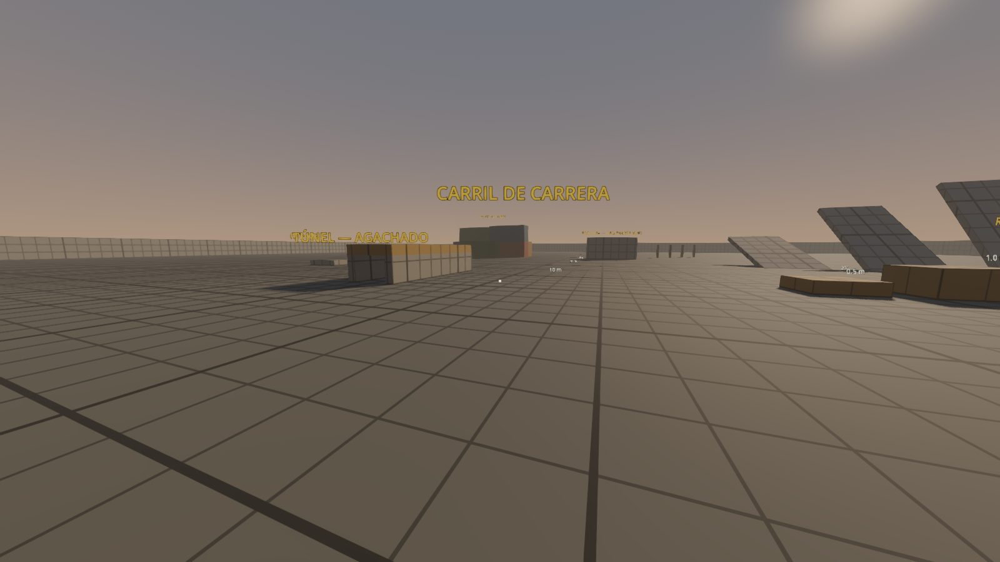

# Medoreador

Shooter táctico de supervivencia en mundo abierto, ambientado en la zona de exclusión de Atucha y el Delta del Paraná. Hecho en **Godot 4.7.2** con GDScript.

> Estado: **F1 — armas, balística y polígono de tiro.** Ver `docs/DEVLOG.md`.

## Abrir el proyecto

1. Instalar Godot **4.7.2** estándar (no .NET) desde https://godotengine.org/download/archive/4.7.2-stable/
2. `git lfs install` (una sola vez) y clonar este repo.
3. Abrir Godot → **Importar** → elegir `project.godot` → **Importar y editar**.
4. **F5** para jugar.

Guía completa de pruebas: [`docs/HOW_TO_TEST.md`](docs/HOW_TO_TEST.md).

## Controles (F0)

| Acción | Tecla |
|---|---|
| Moverse | WASD |
| Mirar | Mouse |
| Correr | Shift (mantener) |
| Saltar | Espacio |
| Agacharse / deslizarse | C (mantener; corriendo = deslizarse) |
| Inclinarse | Q / E |
| Armas | 1 fusil · 2 escopeta · 3 pistola |
| Disparar / Apuntar | Clic izquierdo / Clic derecho (alterna) |
| Recargar / Modo de disparo | R / B |
| Interactuar | F |
| Pausa | Esc |
| Datos de rendimiento | F1 |
| Reporte de bug | F12 |
| Laboratorio: trayectorias / munición infinita | F3 / F4 |

Todo se puede remapear en **Opciones → Controles**.

## Documentación

- [`docs/ARCHITECTURE.md`](docs/ARCHITECTURE.md) — cómo está organizado el código
- [`docs/DECISIONS.md`](docs/DECISIONS.md) — decisiones técnicas y por qué
- [`docs/DEVLOG.md`](docs/DEVLOG.md) — qué se hizo en cada fase
- [`docs/HOW_TO_TEST.md`](docs/HOW_TO_TEST.md) — cómo probar cada entrega
- [`docs/ASSETS.md`](docs/ASSETS.md) — fuente y licencia de cada asset
